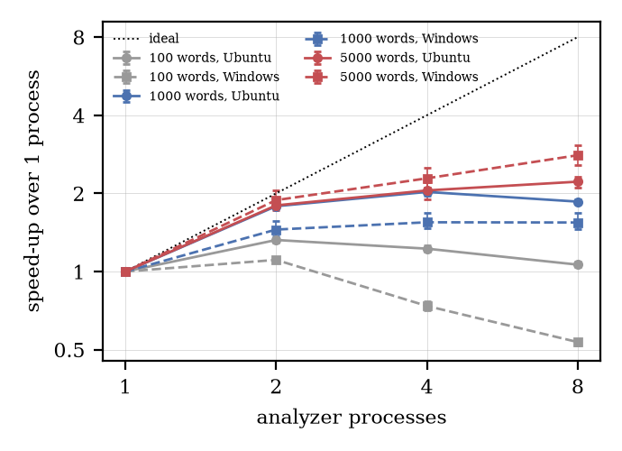
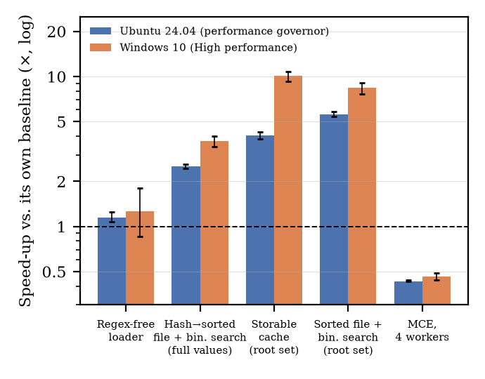

<div align="center">

# Kannada Morphological Analyzer — Performance Optimization

### Dictionary Loading, Lookup and Multicore Evaluation on Ubuntu & Windows

**Manipal Institute of Technology · MAHE · Manipal**

    

**Aryan K Shetty · Siddharth Prabhu · Aniketh Nishikanth Shetty**  
*Project guide: Dr. Ashwath Rao B*

[Research Paper](paper/main.pdf) · [Benchmark Report](BENCHMARK_REPORT.md) · [Raw Results](raw_results/) · [Figures](figures/) · [Scripts](scripts/)

</div>

---

## Overview

Kannada is an agglutinative Dravidian language whose word forms combine roots and grammatical suffixes. This project evaluates the runtime of a **Perl-based, paradigm-driven Kannada morphological analyzer** using a lexical dictionary and finite-state suffix transitions.

We examine three optimization directions: reducing unnecessary regular expressions, evaluating preprocessed dictionary lookup against hash lookup, and using multiple analyzer processes. All reported Ubuntu and Windows experiments were performed on the **same dual-boot laptop**.

> **Core finding:** Preprocessing substantially reduces dictionary load-and-lookup time, but **binary search itself is slower than hash lookup** when loading is excluded. The largest complete-program speedup comes from a bundle of analyzer changes, not dictionary loading alone.

## Results at a glance

| Measurement | Ubuntu 24.04 | Windows 10 (High performance) |
|:--|--:|--:|
| **Whole analyzer, 100 words — original** | 6,326 ms | 18,723 ms |
| **Whole analyzer, 100 words — optimized** | 512 ms | 1,023 ms |
| **Whole-program speedup** | **12.36×** | **18.31×** |
| **Parallel analyzer, 5,000 words, 8 processes** | **2.22×** | **2.81×** |

*Whole-program values are for the quiet-output condition. Parallel speedups are relative to one analyzer process on the same system. Different experiments have different baselines.*

### Dictionary-loading and lookup experiments

| Method | Ubuntu speedup | Windows speedup |
|:--|--:|--:|
| Regex-free loader (P1) | 1.15× | 1.26× |
| Sorted file + binary search, full values (P2) | 2.52× | 3.71× |
| Storable cache, root set (B1) | 4.03× | 10.06× |
| Sorted file + binary search, root set (B1) | 5.60× | 8.40× |
| MCE, 4 workers, root lookups (B1) | 0.43× | 0.46× |

Each speedup uses **its own experiment's baseline**. In isolated lookup measurements, binary search was approximately **20–36× slower** than hash lookup. Windows P1 has a wide confidence interval and does not establish a reliable improvement.

## Research figures

### Figure 1 — Parallel analyzer scaling



*Speedup over one process for batches of 100, 1,000 and 5,000 words. Solid lines represent Ubuntu, dashed lines Windows; error bars indicate 95% bootstrap intervals.*

### Figure 2 — Dictionary optimization speedups



*Mean speedup relative to each experiment's own baseline; whiskers show 95% bootstrap intervals.*

Both plots are generated from the repository's recorded result files by [`scripts/make_figures.py`](scripts/make_figures.py).

## Analyzer and data

| File | Purpose |
|:--|:--|
| [`dict_all.txt`](dict_all.txt) | Lexicon: 105,696 lines, 98,038 distinct roots |
| [`dfsa_270526.txt`](dfsa_270526.txt) | Finite-state transitions: 13,270 lines |
| [`alloMorphMappingFile.txt`](alloMorphMappingFile.txt) | Allomorph mapping file, empty in the received release |
| [`random_words_100.txt`](random_words_100.txt) | Guide-provided 100-word test list |
| [`morph_kan_original.pl`](morph_kan_original.pl) | Original analyzer used for comparison |
| [`morph_kan_optimized_p2.pl`](morph_kan_optimized_p2.pl) | Optimized analyzer variant |

Lexical entries are written in **WX notation**. The analyzer uses paradigm classes and finite-state suffix resolution. The empty allomorph file means allomorph mapping was not evaluated.

## Experimental setup

| Component | Configuration |
|:--|:--|
| Hardware | HP ProBook 450 G9; Intel Core i5-1235U; 8 GB RAM |
| Storage | WD Green SN350, 1 TB SSD |
| Linux | Ubuntu 24.04; Perl 5.38.2; performance governor |
| Windows | Windows 10 Pro 22H2; High-performance power plan |
| Later Windows session | Perl 5.42.2 |

The Perl version for the earlier Windows P1/P2/B1 session was not recorded. Differences between operating systems cannot be isolated from interpreter and session differences.

## Reproduce the figures

The plots can be regenerated **without rerunning the benchmarks**.

```bash
git clone https://github.com/Aniketh2006/kannada-morph-analyzer-optimization.git
cd kannada-morph-analyzer-optimization
python3 -m venv .venv
source .venv/bin/activate
python -m pip install 'numpy<2' matplotlib
python scripts/make_figures.py
```

Generated files:

```text
figures/
├── parallel_scaling.png
├── parallel_scaling.pdf
├── speedups.png
└── speedups.pdf
```

The script also places PDF copies in `paper/`. The relevant summary inputs are `results_summary.csv`, `results_new_linux.csv`, and `results_new_windows.csv`.

<details>
<summary><strong>Repository structure</strong></summary>

```text
.
├── README.md
├── BENCHMARK_REPORT.md
├── dict_all.txt
├── dfsa_270526.txt
├── alloMorphMappingFile.txt
├── random_words_100.txt
├── morph_kan.pl
├── morph_kan_original.pl
├── morph_kan_optimized_p1.pl
├── morph_kan_optimized_p2.pl
├── raw_results/
│   ├── linux_ubuntu_performance/
│   ├── windows_high_performance/
│   └── windows_balanced/
├── scripts/
│   ├── make_figures.py
│   ├── analyze_results.py
│   ├── analyze_new_results.py
│   ├── build_report.py
│   ├── time_analyzers.pl
│   ├── lookup_isolated_benchmark.pl
│   └── parallel_analyzer_benchmark.pl
├── figures/
│   ├── parallel_scaling.png
│   ├── parallel_scaling.pdf
│   ├── speedups.png
│   └── speedups.pdf
├── paper/
│   ├── main.tex
│   ├── main.pdf
│   └── results_tabular.tex
├── docs/
├── results_summary.csv
├── results_new_linux.csv
└── results_new_windows.csv
```

</details>

<details>
<summary><strong>Benchmark scripts and further reproducibility</strong></summary>

The repository contains Perl scripts for whole-analyzer timing, isolated dictionary lookups and parallel analyzer evaluation:

- [`scripts/time_analyzers.pl`](scripts/time_analyzers.pl)
- [`scripts/lookup_isolated_benchmark.pl`](scripts/lookup_isolated_benchmark.pl)
- [`scripts/parallel_analyzer_benchmark.pl`](scripts/parallel_analyzer_benchmark.pl)

It also includes raw timing records under [`raw_results/`](raw_results/), analysis scripts under [`scripts/`](scripts/), and the full [`BENCHMARK_REPORT.md`](BENCHMARK_REPORT.md).

For a new benchmark run, consult the benchmark report and inspect the script arguments and dependencies before execution. Rerun times can differ due to power settings, Perl versions, thermal conditions and operating-system caching.

</details>

## Correctness and interpretation

- On the 100-word test set, original and optimized analyzers produced **byte-identical, non-empty output**.
- The complete-program optimization combines **suffix-test replacement, removal of debugging prints and loader changes**. Their individual contributions were not isolated in the whole-program experiment.
- Parallel dictionary lookups were slower than serial lookups, while parallel **complete-analyzer processes** helped on larger batches.
- The 5,000-word batches repeat the original 100-word list; this is a performance workload, not a separate linguistic coverage evaluation.

## Limitations

This is a same-hardware study on one laptop. Some benchmark groups have only five repetitions; the 100-word list contains known lexicon entries; the allomorph file is empty; and correctness was tested on the selected inputs rather than all possible word forms. Cross-platform absolute timings also reflect differences in Perl versions and experiment sessions. See the [paper](paper/main.pdf) for confidence intervals and threats to validity.

## Paper and citation

**Dictionary Loading and Lookup Optimizations for a Paradigm-Based Kannada Morphological Analyzer: A Same-Hardware Ubuntu and Windows Evaluation**  
Aryan K Shetty, Siddharth Prabhu, Aniketh Nishikanth Shetty  
Manipal Institute of Technology, MAHE, Manipal

[Read the paper (PDF)](paper/main.pdf) · [View LaTeX source](paper/main.tex)

*Publication venue and bibliographic details will be added if and when the paper is accepted.*

## Acknowledgment

This research is associated with the DIDL-DL MT project funded by the Ministry of Electronics and Information Technology (MeitY), Government of India. The authors acknowledge the guidance of Dr. Ashwath Rao B and review contributions of Dr. Dhanusha.

## Permissions

This repository contains analyzer code and lexical resources associated with the project. Public availability does not itself establish redistribution or commercial-use rights. **No open-source license is asserted**; confirm authorization with the project guide before making the repository public or reusing protected resources.

---

<div align="center">

**Research code · Recorded measurements · Reproducible figures**

[Back to top](#kannada-morphological-analyzer--performance-optimization)

</div>
